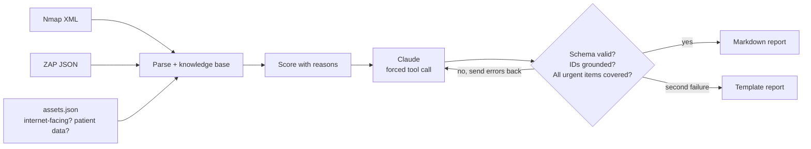

# ScanBrief

**Turn raw security scan output into a ranked, plain-English report a non-technical client can act on.**

Small healthcare practices get security scans from their IT contractor and receive pages of port
numbers and scanner jargon. ScanBrief reads **Nmap** (network) and **OWASP ZAP** (web app) reports,
adds the business context a scanner can't see, ranks every issue with a score it can explain, and
has Claude write a report for the practice owner or the IT contractor.

```text
$ python -m scanbrief samples --report report.md
S-01  10.0  critical Office file server     Remote Desktop is reachable
S-02  10.0  critical Office file server     Windows file sharing (SMB) is reachable
S-03   9.5  high     Office file server     FTP file transfer is open
S-04   9.5  high     Patient portal         Attackers can run scripts in visitors' browsers (cross-site scripting)
S-05   9.5  high     Patient portal         Database queries can be manipulated (SQL injection)
...
```

See [`samples/example_report.md`](samples/example_report.md) for a full report on the sample clinic.

## How it works



**1. Parse.** `parsers.py` reads both formats into one `Finding` model. Down hosts and
closed or filtered ports are ignored. ZAP's HTML descriptions are cleaned, and known ZAP plugin IDs
get plain-language titles (`40018` becomes *"Database queries can be manipulated (SQL injection)"*).

**2. Add context.** The same open port means different things on different machines. Remote
Desktop on the internet-facing file server is **critical**; on the front-desk PC inside the office
it is **medium**. `assets.json` tells ScanBrief which systems are public and which hold patient data.

**3. Score transparently.** `scoring.py` starts from severity and adds points for internet exposure
and patient data, and subtracts for low scanner confidence. Every adjustment is stored as a
sentence (`"reachable from the internet (+1.5)"`), so the ranking can be explained to a client.

**4. Write with Claude, then verify.** The model must answer through a `write_report` tool whose
input schema is generated from the `ClientReport` pydantic model, so the output is always structured.
Each draft is then checked:
- **Schema:** pydantic validation (types, allowed owners, effort levels, list sizes)
- **Grounding:** every cited finding ID must exist, so the model can't invent issues
- **Coverage:** every critical and high finding must appear in some risk item

If a check fails, the specific errors go back to the model as a tool error for one retry. If the
retry fails too, ScanBrief falls back to a deterministic template report, so the user always gets
something accurate.

**5. Map to HIPAA.** Each finding links to the related HIPAA Security Rule technical safeguard
(45 CFR 164.312: access control, audit controls, integrity, authentication, transmission security).
The mapping is deterministic, not generated, and the report says it is a starting point for
discussion, not a compliance determination.

## Run it

```bash
python -m venv .venv && source .venv/bin/activate
pip install -r requirements-dev.txt

python -m scanbrief samples                               # ranked findings
python -m scanbrief samples --report report.md --offline  # template report, no API key
pytest -q                                                 # 15 tests

export ANTHROPIC_API_KEY=sk-ant-...
python -m scanbrief samples --report report.md --audience executive   # or technical
streamlit run app.py
```

To scan your own lab (only systems you are authorized to test):

```bash
nmap -sV -oX scans/nmap.xml 192.168.56.0/24
# ZAP: run a baseline scan and export Report > JSON into scans/
python -m scanbrief scans --report report.md
```

`assets.json` maps an IP or hostname to context:

```json
{"203.0.113.12": {"name": "Office file server", "internet_facing": true, "handles_phi": true}}
```

## Safety notes

- Scan files are untrusted input. XML with entity declarations is rejected before parsing.
- Only scored findings, not raw scanner dumps, are sent to the model.
- The sample data describes a fictional clinic on reserved documentation IP ranges.

## Project layout

```
scanbrief/
  models.py      pydantic models for findings and the report schema
  knowledge.py   port and ZAP plugin rules, HIPAA safeguard mapping
  parsers.py     Nmap XML and ZAP JSON parsers
  scoring.py     explainable priority scores
  report.py      Claude structured output, validation + retry, template fallback, Markdown
samples/         fictional clinic: Nmap scan, ZAP scan, assets.json, example report
tests/           15 tests, including a fake client that exercises the retry loop
```

## Next steps

- Flag outdated service versions by checking them against a CVE feed
- Compare two scans and report what was fixed and what is new
- Add Nessus and OpenVAS parsers

---
Built by [Sandra Sumesh](https://github.com/sandrasumesh). The idea came from running vulnerability scans and penetration tests for healthcare clients.
